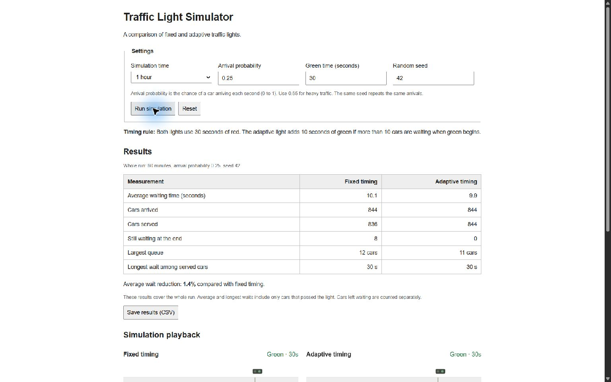
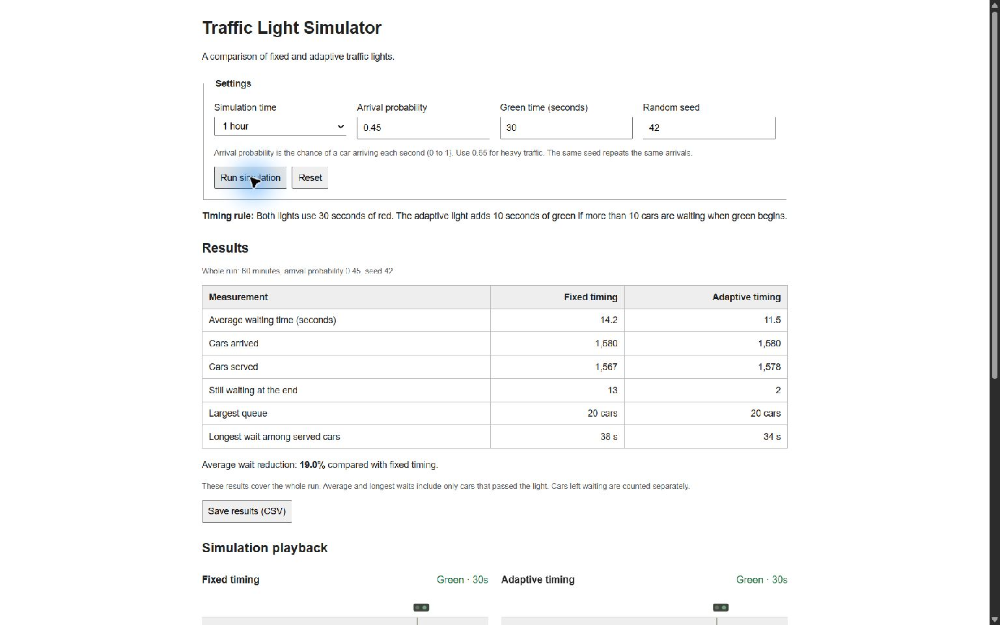
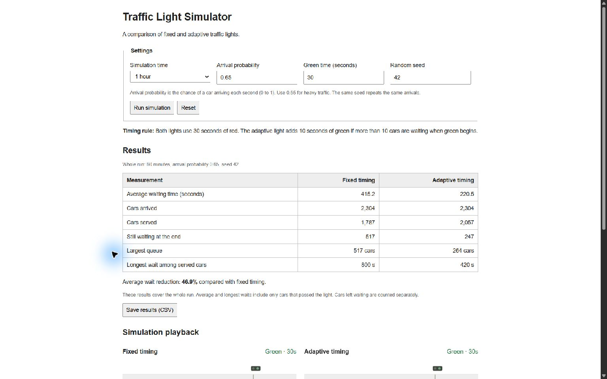

# Traffic simulator screenshots

These full-screen desktop screenshots are 1536 × 960 pixels. Each shows one run of the simulator. The duration (1 hour), green time (30 seconds), and random seed (42) stay the same. The arrival probability changes.

| Traffic | Arrival probability | Fixed average wait | Adaptive average wait | Wait reduction |
| --- | ---: | ---: | ---: | ---: |
| Light | 0.25 | 10.1 seconds | 9.9 seconds | 1.4% |
| Moderate | 0.45 | 14.2 seconds | 11.5 seconds | 19.0% |
| Peak | 0.65 | 415.2 seconds | 220.5 seconds | 46.9% |

The waits are averages for cars that passed the light. The screenshot also shows how many cars are still waiting when the hour ends. Both timing rules get the same arrivals for each run. At 0.65 arrivals per second, the queue continues to grow, since the arrival rate is above the fixed light's maximum service rate.

## Light traffic

## Moderate traffic

## Peak traffic

